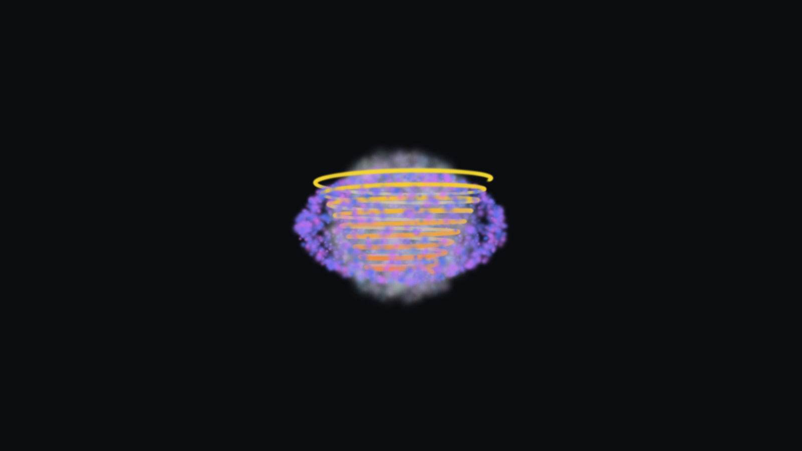
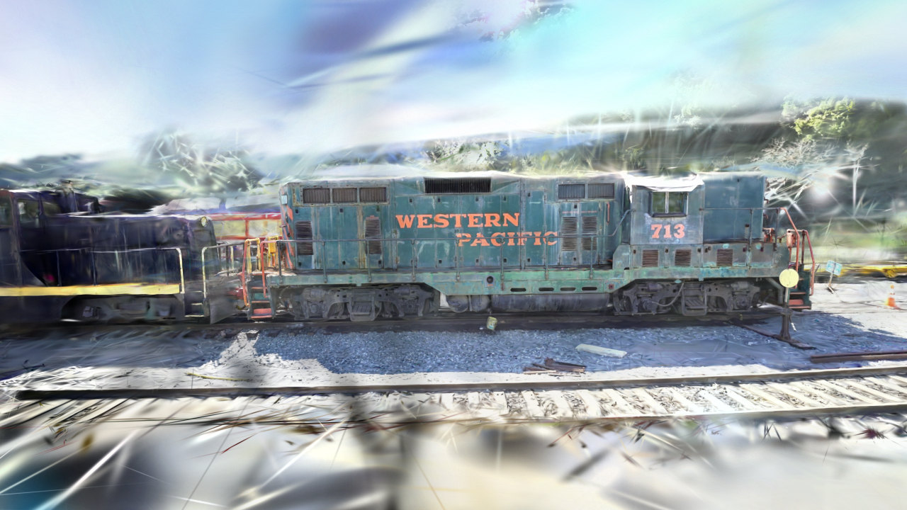

# Radiance4D

Hybrid real-time rendering and spatiotemporal reconstruction engine featuring 3D/4D Gaussian
Splatting, photogrammetry, ray tracing, and temporal stability.

C++20, with native Direct3D 12 and Vulkan backends.

## Status

Milestone M3 complete, M4 under way. Features marked *planned* are not implemented.

| Area | Status |
|---|---|
| Win32 platform layer, logging, timing | working |
| D3D12 device, explicit adapter selection | working |
| DirectX Agility SDK (retail 1.619.6) | working |
| Enhanced Barriers | working |
| Swapchain, frame synchronisation, resize | working |
| Build-time HLSL to DXIL (DXC 1.9.2609) | working |
| Debug layer, DRED, validation counters | working |
| Indexed and non-indexed geometry | working |
| GPU timestamp profiling | working |
| Headless rendering and frame capture | working |
| WARP image-regression tests, CI | working |
| Depth buffering | working |
| Orbit and free-fly cameras | working |
| glTF loading (cgltf) | working |
| PBR shading, analytic lights | working |
| Base colour, metallic-roughness, normal maps | working |
| ImGui statistics overlay | working (both backends) |
| Image-based lighting (procedural sky) | working |
| Shadow mapping (key light, PCF) | working |
| Exposure control | working |
| Vulkan backend (1.3, dynamic rendering, synchronization2) | working |
| Cross-API image parity test | working |
| 3D Gaussian Splatting (projection, sorting, compositing) | working (both backends) |
| 3DGS `.ply` dataset loading | working (verified on the INRIA `train` and `truck` scenes, 1.03M and 2.54M splats) |
| Spherical-harmonic colour (degree 3) | working (both backends) |
| Splat GPU depth sorting | working (compute radix sort, both backends) |
| Splat visibility culling, tiled binning | planned (M4) |
| COLMAP sparse model to renderable splats | working (Python, no dependencies) |
| COLMAP pose estimation, gsplat training | planned (M5), needs tools not installed here |
| Hybrid mesh and Gaussian rendering | working (shared depth buffer) |
| Temporal reprojection and denoising | planned (M7) |
| Dynamic 4D Gaussians | planned (M8) |


## Gaussian splatting

`--splats <n>` renders a deterministic procedural cloud of 3D Gaussians, and `--splat-ply <file>`
loads a published 3DGS dataset instead. Each splat carries a position, a linear scale, a rotation
quaternion, an opacity and 16 spherical-harmonic coefficients per channel; the vertex shader builds
the 3D covariance, projects it with the perspective Jacobian into a screen-space conic, evaluates
the SH colour from the view direction, and expands a quad from `SV_VertexID`. That Jacobian is a
local linearisation of the perspective divide, so the off-axis ratio is clamped to 1.3 times the
half-frustum before it is built, as the reference implementation does. The pixel shader evaluates
the conic and emits premultiplied alpha, and the splats are composited back to front in the order a
compute radix sort writes earlier in the same frame.

Without `--scene` the splats replace the mesh scene; with one they share its depth buffer, so
geometry occludes the splats behind it. Both backends draw the pass from the same HLSL, and the
parity test holds them to the same image.

### The depth sort

Alpha compositing is order-dependent, so every splat has to be ordered against every other one each
time the camera moves. That sort runs on the GPU: five compute kernels, four passes over an 8-bit
digit of a 32-bit key, compiled from one HLSL source to both DXIL and SPIR-V like everything else
here.

The key is the view-space depth under a monotonic bit transform rather than a quantised range, so
the ordering is exact, and the sort is stable, so equal depths keep their buffer order. On `train`
that is enough for the GPU order to reproduce the CPU sort it replaced **pixel for pixel**: 0 of
921,600 pixels differ at 1280x720, on both backends. Backend parity is unchanged by the switch, at
the same max channel delta 23 and RMSE 0.6806 the CPU sort produced on this view.

Per pass, each tile of 256 splats counts its digits into a histogram written digit-major; one group
per digit scans that digit's row; one group scans the 256 row totals; and each tile then scatters,
taking its destination as the digit's offset in the frame plus the tile's offset within the digit
plus the element's rank among the tile's elements sharing it. That rank comes from a 256-bit mask
per digit, one groupshared atomic per element. Scratch is per frame in flight, so the sort needs no
barrier against the previous frame's reads: the per-slot fence wait has already happened.

The order buffer moved from a CPU-visible upload heap to device-local memory as part of this, which
also takes the vertex shader's per-instance order fetch off the PCIe bus.

```
radiance4d_viewer.exe --splats 20000
radiance4d_viewer.exe --splat-ply path/to/point_cloud.ply
radiance4d_viewer.exe --splats 1200 --scene assets/DamagedHelmet/DamagedHelmet.glb
```



### Datasets

The loader takes the binary little-endian `.ply` the 3DGS reference implementation writes. Header
properties are matched by name, since exporters disagree on field order, and the stored activations
are converted on load: scales are exponentiated, the `wxyz` quaternion is normalised, and the
opacity goes through a sigmoid. Degree 0, 1, 2 and 3 files all load; bands the file does not carry
stay zero. ASCII and big-endian files, list properties and multi-element files are refused with an
error rather than guessed at.

Published scenes are hundreds of megabytes to several gigabytes, so none is committed here and the
test suite writes its own synthetic files instead. Loading one is a manual step: download a trained
`point_cloud.ply` (for example from the INRIA 3DGS release) and pass it to `--splat-ply`.

**Coordinate frame.** COLMAP's world frame, which 3DGS trains in, is right-handed with +y down,
while the engine is left-handed with +y up, so the loader mirrors y. Positions, the rotation
quaternion and the spherical harmonics all have to move together. With `M = diag(1, -1, 1)` the
covariance `M (R S S^T R^T) M^T` keeps its scales and takes the rotation `M R M`, which is the
quaternion `(w, x, y, z)` becoming `(w, -x, y, -z)`; the six SH bands whose basis polynomial is odd
in y change sign, so the colour along a direction survives the flip. Without the mirror a published
scene loads upside down.

That frame was not guessed. The INRIA `train` model ships a `cameras.json`, and averaging the
image-down axis of its 301 cameras gives a world direction 4.7° off +y, with 297 of the 301 within
25° of that mean — the capture's own idea of "down" is the file's +y.

**What a published scene actually did.** INRIA 3DGS pre-trained `train` (Tanks and Temples),
`point_cloud/iteration_30000/point_cloud.ply`: 1,026,508 splats, 62 properties, SH degree 3,
243 MiB on disk and 234.9 MiB of GPU attributes. Headless at 1280x720, 8 frames, fixed step, RTX
3080 Laptop GPU:

- Zero validation errors on both backends, in Debug with the debug layer and validation layer on
  and in RelWithDebInfo.
- D3D12 against Vulkan: max channel delta 1, RMSE 0.0089, 172 of 921,600 pixels differ. Debug and
  RelWithDebInfo captures are byte-identical within a backend.
- Parse and convert 0.41 s, upload 0.08 s (RelWithDebInfo, warm file cache, i7-11800H); 2.0 s and
  0.25 s in Debug.
- The mirror is a rigid flip and nothing else: the corrected capture matches the vertical flip of
  the un-mirrored one to max delta 5 / RMSE 0.0111. Mirroring positions alone, leaving the rotation
  and SH in the file's frame, gives max delta 244 / RMSE 5.2367 against the same reference, which is
  what makes that comparison worth running.
- The colour is view-dependent, not flat. Rendering a degree-0 copy of the same file — identical
  geometry, `f_rest` dropped — differs by max channel delta 77, RMSE 0.9092 over 13,494 pixels.
  Across the splats themselves the colour moves a median 0.19 in 0..1 units over ten view
  directions, against a median degree-0 contribution of 0.28.

**A second scene, 2.5x the size.** INRIA 3DGS pre-trained `truck`, same release and the same
`point_cloud/iteration_30000/point_cloud.ply`: 2,541,226 splats, 62 properties, SH degree 3, 601 MiB
on disk, 581.6 MiB of GPU attributes and 96.9 MiB of sort scratch across both frames in flight.

- Zero validation errors on both backends, Debug with the debug layer and the validation layer on,
  and the D3D12 live-object report is empty.
- Parse and convert 1.17 s, upload 0.15 s (RelWithDebInfo, warm file cache), against 0.47 s and
  0.07 s for `train` on the same build — 2.48x and 2.32x the time for 2.48x the splats, so loading
  is linear in the splat count.
- Nothing degrades with the size. 678.5 MiB of splat buffers against 15.80 GiB of adapter memory,
  and a procedural 4M-splat cloud (915 MiB of attributes, 152 MiB of scratch) runs on both backends
  as well.
- The capture is a featureless white field, which is the Jacobian defect below and not something the
  larger scene introduced. Both the parity figure and the frame times have to be read with that in
  mind, and both are given below with and without a clamp applied as a probe.

Current limits: 240 bytes
of attributes per splat (degree-3 SH is 192 of them), which is 240 MB for a million-splat scene --
of which the sort reads only the 12 bytes of position. Tile binning adds four more arrays over the
(tile, splat) pairs, 8 per splat, which is another 264 MiB at 1.03M splats across both frames. The sort itself adds 39.2 MiB of scratch at
1.03M splats and 96.9 MiB at `truck`'s 2.54M, across both frames in flight. Both are linear in the
splat count, so the 6.13M-splat `bicycle` scene would want about 1.4 GiB of attributes and 233 MiB
of scratch.

A splat cloud is no longer framed on its bounding sphere. A reconstruction leaves sparse
low-opacity splats far outside the subject, so that sphere is dominated by outliers: in `train` it
has radius 145 about a centre 35 units from the scene, and the camera ended up 326 units back with
the subject a few percent of the frame. The cloud now also carries a framing sphere — the per-axis
median position, and the distance half the splats are within — which `train` puts at radius 2.4 and
the camera 5.5 back. The full bounds are unchanged and still carry culling, the near and far planes
and the merge with a mesh's bounds; mesh scenes still frame exactly as before.

The dataset's own capture poses say that is the right place to stand: the 301 cameras in `train`'s
`cameras.json` sit a median 3.42 and at most 7.35 units from the scene centre, and the median splat
position lands 0.07 units from the median of those camera positions.

That agreement does not generalise, and `truck` is where it breaks. Its 251 capture cameras stand a
median 4.12 and at most 6.40 units from the scene centre, but half its splats lie 12.5 units or
further out — it reconstructs a large surrounding background rather than a subject on a plinth —
so the framing sphere comes out at radius 12.6 and the camera 28 units back, four times beyond the
furthest camera that ever photographed it. That is still far better than the bounding sphere, which
has radius 111.6 and would put the camera 251 units back, but "the distance half the splats are
within" turns out to measure how much background a scene reconstructed rather than where it was shot
from. Checking the framing radius against the dataset's own `cameras.json` is the part worth
keeping; a heuristic that reads the capture poses when a dataset ships them would be better still.

**Why the Jacobian is clamped.** Without that clamp a published scene renders as a featureless
near-white wash the moment the camera is close enough to stand inside the reconstruction: a splat
off to the side gets a covariance that covers the whole frame. At the camera below, the clamped
and unclamped captures differ over 99.98% of the frame, so this is the difference between a
picture and nothing. It costs the procedural cloud almost nothing — the same 640x360 WARP render
moves 33 of 230,400 pixels by one level, and the stored reference image still passes unchanged.
The symptom only appears on a reconstruction because the old framing stood 326 units back, where
every splat is near the axis.

**Aiming a capture.** The orbit camera starts at yaw 0 and pitch 0, which for `train` looks into
trackside foliage. `--orbit-yaw <deg>` and `--orbit-pitch <deg>` set that starting direction;
both default to 0, so nothing moves unless they are passed, and they are what makes a chosen view
reproducible from a command line. Pitch tilts the view the way dragging does, so a negative pitch
looks down on the subject from above. No per-scene direction is baked in: 150° suits `train` and
is written down here, not in the code.

```
radiance4d_viewer.exe --headless --splat-ply path/to/point_cloud.ply --orbit-yaw 150 --width 1280 --height 720 --frames 8 --fixed-step 0.016 --out docs/images/train-dataset.png
```



That command produced the image above, on an RTX 3080 Laptop GPU (driver 617.14) in a Debug build
with the D3D12 debug layer on, and two runs of it are byte-identical. Rendered the same way on
Vulkan, with the validation layer on, both backends report zero validation errors and the two
captures agree to a max channel delta of 2, RMSE 0.0447, with 4,508 of 921,600 pixels differing
(0.49%).

The streaking along the bottom edge and across the sky is not a rendering defect to fix in the
projection: those are the handful of splats with very large scales (the largest linear scale in
this file is 16.2 units against a median of 0.016, and 1% of them exceed 0.37), seen from a camera standing among them. A
visibility pass that drops splats whose screen-space extent is implausible is M4 work that has not
been done.

`truck` hits the same defect, and harder. At its framing camera every pixel of the 1280x720 capture
lands between 253 and 255 on all three channels: 100% of pixels at or above 250, standard deviation
under 1.1, no structure at all. Applying the clamp as a local probe on the same build renders the
scene instead — foliage, the red truck, the ground behind it — with values spread over 0..255 and
only 0.37% of pixels near white. The probe was measured and reverted, not committed here.

That is what the parity figure turns on. Measured on the washed-out image, D3D12 against Vulkan on
`truck` gives max channel delta 1, RMSE 0.0079, 74 of 921,600 pixels, which is two featureless
fields agreeing and says nothing. Measured with the clamp, the same comparison is max channel
delta 2, RMSE 0.0380, 3,360 pixels, and that is the honest parity statement for this scene.

## Reconstruction tooling

`tools/reconstruct` turns a photogrammetry reconstruction into something the engine renders, in
Python with no dependencies:

```
python -m r4drecon inspect <sparse-model-folder>
python -m r4drecon export  <sparse-model-folder> out.ply
```

`export` writes COLMAP's 3D points as a 3DGS `.ply` that `--splat-ply` loads. Each point becomes one
splat with its colour, a fixed low opacity, an identity rotation and an isotropic scale taken from
the distance to its three nearest neighbours — the initialisation the reference implementation
optimises from, so a sparse reconstruction is viewable before any training has run. The neighbour
search goes through a uniform grid rather than comparing every pair, which keeps it linear: 28,000
points take about 8 seconds.

Only COLMAP's binary model is read; a text one converts with `colmap model_converter
--output_type BIN`. Nothing in the tool changes coordinate frames, so a file it writes and a file
downloaded from a published scene are treated identically by the loader's mirror.

Pose estimation and training are not implemented. `python -m r4drecon train` reports what they would
need — COLMAP, PyTorch with CUDA, and gsplat — none of which is installed here, rather than failing
obscurely. `tools/reconstruct/README.md` has the detail.

## Measurements

`--benchmark <n>` renders headless with the debug layer off, discards 64 warm-up frames and reports
CPU and GPU frame time. GPU time comes from timestamp queries around the frame, and from one pair
per splat pass inside it; `--no-pass-timings` drops the inner pairs. `--grid <cols>x<rows>` sizes the
built-in scene.

RTX 3080 Laptop GPU (GA104, 16 GB), driver 617.14, i7-11800H, RelWithDebInfo, vsync off, mean of the
measured frames:

| Scene | Resolution | Backend | CPU | GPU |
|---|---|---|---|---|
| 7x5 grid, 36 draws, 108k tris | 1920x1080 | D3D12 | 0.164 ms | 0.142 ms |
| 7x5 grid, 36 draws, 108k tris | 1920x1080 | Vulkan | 0.214 ms | 0.148 ms |
| 24x16 grid, 385 draws, 1.18M tris | 1920x1080 | D3D12 | 0.433 ms | 0.412 ms |
| 24x16 grid, 385 draws, 1.18M tris | 1920x1080 | Vulkan | 0.408 ms | 0.379 ms |
| 24x16 grid, 385 draws, 1.18M tris | 3840x2160 | D3D12 | 0.599 ms | 0.574 ms |
| 24x16 grid, 385 draws, 1.18M tris | 3840x2160 | Vulkan | 0.593 ms | 0.568 ms |
| INRIA `train`, 1.03M splats, CPU sort | 1920x1080 | D3D12 | 96.074 ms | 35.285 ms |
| INRIA `train`, 1.03M splats, CPU sort | 1920x1080 | Vulkan | 99.731 ms | 32.387 ms |
| INRIA `train`, 1.03M splats, GPU sort | 1920x1080 | D3D12 | 22.475 ms | 22.455 ms |
| INRIA `train`, 1.03M splats, GPU sort | 1920x1080 | Vulkan | 18.707 ms | 18.677 ms |
| INRIA `train`, 1.03M splats, + cull pass | 1920x1080 | D3D12 | 14.866 ms | 14.846 ms |
| INRIA `train`, 1.03M splats, + cull pass | 1920x1080 | Vulkan | 12.172 ms | 12.041 ms |
| INRIA `train`, 1.03M splats, + tile raster | 1920x1080 | D3D12 | 9.920 ms | 9.900 ms |
| INRIA `train`, 1.03M splats, + tile raster | 1920x1080 | Vulkan | 10.435 ms | 10.408 ms |
| INRIA `truck`, 2.54M splats, GPU sort | 1920x1080 | D3D12 | 14.718 ms | 14.698 ms |
| INRIA `truck`, 2.54M splats, GPU sort | 1920x1080 | Vulkan | 14.045 ms | 14.018 ms |

**What these do and do not show.** The mesh scene never loads the GPU: 1.18 million triangles cost
0.41 ms, and quadrupling the pixel count to 4K only reaches 0.57 ms, so the frame is bounded by
fixed per-frame cost rather than by geometry or fill. Headless means no present, so swapchain cost
is excluded.

The one thing the numbers do support is where the backends differ. On the light scene Vulkan is
0.05 ms behind on CPU; by 4K the two are within 0.006 ms of each other. The gap is command
submission overhead, which stops mattering as soon as the frame has real work in it, and it is not a
statement about shading performance. Drawing a D3D12-versus-Vulkan conclusion from this would be
wrong.

The splat rows are the opposite case, and they are the first scene here heavy enough to be worth
measuring. The two CPU-sort rows are what the pass cost before the sort moved: 96 and 100 ms of CPU
against 35 and 32 ms of GPU, a frame spent sorting, with every one of the 1.03M splats depth-sorted
on one core every frame. Both backends landed within 4 ms of each other because they ran the same
sort; that said nothing about D3D12 against Vulkan.

Moving the sort to the GPU takes the CPU frame to 22.475 and 18.707 ms, and the CPU figure is now
within 0.03 ms of the GPU one on both backends — the CPU is no longer doing the work, it is waiting
for the GPU, and the frame is GPU-bound for the first time.

The GPU figure fell as well, from 35.285 to 22.455 ms on D3D12. That is not the sort being free: it
is mostly the order buffer leaving the upload heap, which stops the vertex shader fetching a
`uint` per instance across PCIe. A control at 20,000 splats, where neither build is CPU-bound and
the GPU is loaded the same either way, puts the two within 0.062 ms of each other (2.414 against
2.476 ms), so the difference at a million splats is work removed rather than a clock artefact.

The CPU and GPU figures stay locked together at 2.54M splats — 14.718 against 14.698 ms on D3D12,
14.045 against 14.018 on Vulkan — so nothing has crept back onto the CPU at 2.5x the work.

**2.5x the splats is cheaper, not dearer, and that is the result.** `truck` carries 2,541,226 splats
against `train`'s 1,026,508, and its frame costs 14.698 ms of GPU against `train`'s 22.050 ms on
D3D12. (`train` was re-run alongside it on the same build and reproduced the published row to within
0.5 ms; the `truck` rows are the mean of three 100-frame runs.) The frame is not bounded by the
splat count. It is bounded by rasterised area, and at their respective framing cameras `train`
covers far more screen per splat than `truck` does. The defect above is not what produces that
ordering either: with the clamp applied as a probe, the same comparison is `truck` 9.432 ms against
`train` 14.470 ms, so both get cheaper and `truck` stays the cheaper one.

Shrinking the render target to 160x90 removes essentially all of the fill and leaves the
view-independent work, which is the sort plus the per-splat projection. Mean GPU time over three
100-frame runs, clamp probe applied so both scenes project the same way:

| 160x90 | `train`, 1.03M | `truck`, 2.54M | ratio |
|---|---|---|---|
| D3D12 | 2.472 ms | 6.123 ms | 2.477 |
| Vulkan | 2.182 ms | 7.217 ms | 3.308 |

Against a splat-count ratio of 2.476, D3D12 is linear to within 0.1%. Vulkan is not: it is 12%
cheaper than D3D12 at a million splats and 18% dearer at 2.5 million. A procedural sweep, which
holds the data distribution fixed and varies only the count, puts the crossover between 2M and
2.54M splats and has the gap still widening at 4M:

| 160x90, GPU | 250k | 500k | 1M | 2M | 2.54M | 4M |
|---|---|---|---|---|---|---|
| D3D12 | 0.886 | 1.669 | 3.432 | 7.127 | 8.105 | 13.279 ms |
| Vulkan | 0.764 | 1.620 | 3.340 | 6.863 | 8.960 | 14.698 ms |

From 1M to 4M D3D12 goes up 3.87x for 4x the splats; Vulkan goes up 4.40x. These runs predate the
per-pass timestamps and have not been re-run with them, so which kernel bends is still open at those
counts; the split at 1080p is below.

**What the cull pass changed.** The vertex shader used to rebuild the 3D covariance, the Jacobian
and the whole degree-3 spherical-harmonic sum at each of a quad's four corners — four times the work
for one answer. The pass that already walked every splat to build its sort key now projects it as
well and leaves a 48-byte screen-space record, and the vertex shader reads that. The same pass
collapses to a zero radius any splat whose quad cannot reach a pixel. On `train` at 1080p that is
22.455 ms to 14.846 ms on D3D12 and 18.677 to 12.041 on Vulkan.

The rejection is exact — a splat is dropped only when it cannot colour a pixel — and the measurement
says so: removing the viewport test from the pass leaves the capture identical, the same 2,619
pixels from the one before the change, which are precision and not geometry. That is also why the
stored WARP reference still passes untouched.

An indirect draw was tried and removed. Counting the survivors and issuing `ExecuteIndirect` with
that instance count measured 14.846 ms against 14.530 for collapsing the culled splats instead,
which is within run-to-run noise, and the pinned WARP draws nothing at all through `ExecuteIndirect`
— reproduced with the argument buffer filled by the CPU, so it is not the compute write. Paying a
CI blind spot for no measured gain was not worth it.

**What the tile rasteriser changed.** A back-to-front blend cannot stop early: the quad pass had to
blend every splat covering a pixel, however opaque the pixel had already become. The splats are now
binned into 16x16 tiles and one compute group owns a tile, walking it from the nearest splat
outwards and stopping once the transmittance can no longer change the pixel. On `train` at 1080p
that is 14.846 ms to 9.900 on D3D12 and 12.041 to 10.408 on Vulkan — and 22.455 to 9.900 against
the version before either change.

The binning avoids a second sort key. Pairs are generated by walking the splats in depth order, so
they start out sorted by depth, and the tile sort is the same stable radix sort over the tile id
alone, which leaves each tile's slice in depth order. Two passes cover a 16-bit tile id. The
rasteriser walks a slice backwards to composite near to far.

Capacity for the pairs is fixed when a cloud is uploaded, at eight per splat. The frame reads the
scan's grand total back and reports a view that needed more instead of dropping splats silently:
`train` at 1080p peaks at 4.55 million pairs against the 8.2 million it holds. Raising the capacity
to sixteen produces a byte-identical image and costs 2.7 ms, which is what fixes it at eight.

This is also where the stored WARP reference moved. The quad pass blended into the 8-bit render
target once per splat, so hundreds of overlapping splats accumulated hundreds of roundings; the
rasteriser accumulates in floating point and writes once. The reference was retaken, and the change
it records is 2787 of 230400 pixels moving by at most 9 levels. Cross-backend agreement improved at
the same time, from max channel delta 2 over 0.49% of pixels to delta 1 over 0.046%.

**Where the splat frame goes.** Six timestamp scopes bracket the splat path: the cull pass, the
eight-pass depth radix sort, tile binning, the two-pass tile sort with its per-tile ranges, the tile
rasteriser and the composite draw. Sixteen radix dispatches collapse into two entries on purpose —
the question is which stage dominates, not which of eight identical passes does. `train` at
1920x1080, `--benchmark 200`, mean of the measured frames:

| Pass | D3D12 | Vulkan |
|---|---|---|
| Cull | 0.91 ms | 0.74 ms |
| Depth sort | 0.81 ms | 0.74 ms |
| Binning | 1.38 ms | 1.27 ms |
| Tile sort | 2.74 ms | 4.00 ms |
| Rasterise | 3.82 ms | 3.59 ms |
| Composite | 0.04 ms | 0.04 ms |
| sum of the six scopes | 9.69 ms | 10.37 ms |
| whole-frame pair | 9.70 ms | 10.38 ms |

The scopes account for the frame to within 0.01 ms, which is the check that they bracket what they
claim to. The rasteriser is the largest single pass on D3D12 at 39% of the frame, but it is not most
of it: the depth sort, the binning and the tile sort together are 51%, and the tile sort alone costs
more than the depth sort that feeds it. That is the answer the earlier rows could not separate — the
cost is in getting the splats into tiles, not only in shading them. The cull pass projecting a
million splats is 0.91 ms, and the composite is noise.

The backends disagree in one place and agree everywhere else. Vulkan's tile sort is 4.00 ms against
D3D12's 2.74, a 1.26 ms gap, and it is more than the 0.68 ms by which Vulkan's whole frame is
dearer: Vulkan is cheaper in every other pass — cull by 0.17, rasterise by 0.23, depth sort and
binning by 0.18 between them — and those 0.58 ms absorb the rest of it exactly. The same radix
kernels run on both backends, so this is a dispatch or barrier difference around the pair buffers
rather than shader performance, and it is the first thing to look at next.

The instrumentation itself does not cost anything measurable. Paired `--benchmark 200` runs with and
without `--no-pass-timings`, interleaved three times per backend, put the whole-frame mean at
9.75 ms with the scopes on against 9.74 off on D3D12, and 10.28 against 10.26 on Vulkan: differences
of 0.02 ms against a run-to-run spread of 0.3 ms. The twelve extra timestamps per frame do not show
up.

A sampling profiler is still outstanding. This attributes GPU time per pass, not per instruction,
and it cannot say why a pass costs what it does.

## Building

Windows 11, Visual Studio 2022 (v143), CMake 3.26+, a D3D12 GPU. Dependencies are fetched and
hash-pinned by CMake; nothing is installed system-wide.

```
cmake --preset windows-d3d12
cmake --build --preset windows-d3d12-debug
ctest --preset windows-d3d12-debug
```

See [docs/BUILDING.md](docs/BUILDING.md).

## Running

```
build/windows-d3d12/bin/Debug/radiance4d_viewer.exe
```

`--backend <d3d12|vulkan>`, `--scene <file.gltf>`, `--splats <n>`, `--splat-ply <file.ply>`,
`--adapter <index|warp|name>`, `--no-vsync`, `--gpu-validation`,
`--frames <n>`, `--resize-cycles <n>`, `--log-level <0..5>`. `--help` lists all flags.
Without `--scene` a built-in material grid is rendered. Esc quits, F1 toggles vsync, F2 switches
camera mode; left mouse orbits, right pans, wheel zooms, WASDQE moves in free-fly. Exit code is non-zero if the
debug layer reported an error.

Headless, no GPU required:

```
radiance4d_viewer.exe --headless --frames 30 --fixed-step 0.0166667 --out frame.png
```

## Documentation

- [docs/ARCHITECTURE.md](docs/ARCHITECTURE.md)
- [docs/ROADMAP.md](docs/ROADMAP.md)
- [docs/BUILDING.md](docs/BUILDING.md)

## License

MIT, see [LICENSE](LICENSE).

Fetched at configure time under their own licenses: GLM (MIT), GoogleTest (BSD-3-Clause), DirectX
Shader Compiler (LLVM/NCSA + MIT), DirectX Agility SDK and WARP (Microsoft; `D3D12Core.dll`,
`d3d12SDKLayers.dll`, `d3dconfig.exe` and `d3d10warp.dll` are redistributable per the package terms),
stb (MIT / public domain), cgltf (MIT), Dear ImGui (MIT).
