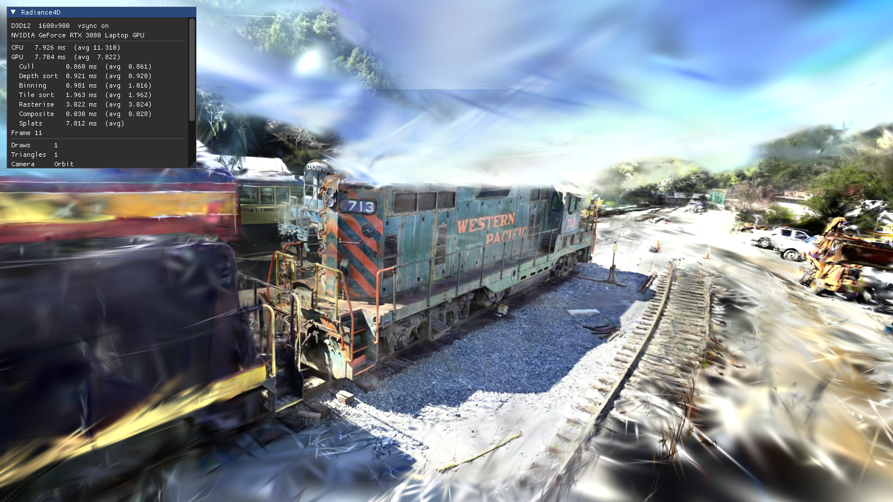

# Radiance4D

[](https://github.com/ginzburg-dev/radiance4d/actions/workflows/windows_build_and_test.yaml)
[](https://opensource.org/licenses/MIT)

Radiance4D renders 3D Gaussian splats and triangle meshes in one scene. It has native Direct3D 12
and Vulkan backends and compiles one set of HLSL shaders for both. A million splats draw at 1080p
in 9.7 ms, through a compute pipeline that culls, depth sorts, bins into tiles and composites front
to back. Load a photogrammetry scan, put a model into it, and the two occlude each other correctly.



---

## Use it for

* **Virtual production and previs.** Put CG into a scanned location and walk it live.
* **VFX layout.** A scanned environment behind a CG element instead of a flat plate.
* **Digital twins.** A scanned site with CAD or markup on top.
* **A base to build on.** The whole splatting pipeline, readable, in one repository.

The reference splatting code is CUDA, so it needs an NVIDIA card. This one is plain HLSL and runs
on any Direct3D 12 or Vulkan GPU.

---

## The splat pipeline

* **Cull and project.** The 3D covariance goes through the perspective Jacobian and comes out a
  screen-space ellipse. Spherical-harmonic colour is evaluated here, once per splat.
* **Depth sort.** A GPU radix sort over the whole scene. The key carries the full float depth, so
  the order is exact, and the sort is stable.
* **Tile binning.** 16x16 tiles. Pairs are built in depth order and sorted by tile id, so each
  tile's list stays sorted by depth without a second key.
* **Tile rasterise.** One compute group per tile, one thread per pixel, front to back, stopping as
  soon as the pixel saturates.
* **Composite.** Over the mesh image, depth tested per splat against what the mesh pass wrote.


---

## Performance

INRIA's `train`, 1,026,508 splats at spherical-harmonic degree 3, at 1920x1080. RTX 3080 Laptop
GPU, driver 617.14, i7-11800H, RelWithDebInfo, vsync off, mean of 200 frames.

| Pass | D3D12 | Vulkan |
|---|---|---|
| Cull | 0.91 ms | 0.74 ms |
| Depth sort | 0.81 ms | 0.74 ms |
| Binning | 1.38 ms | 1.27 ms |
| Tile sort | 2.74 ms | 4.00 ms |
| Rasterise | 3.82 ms | 3.59 ms |
| Composite | 0.04 ms | 0.04 ms |
| **Frame** | **9.70 ms** | **10.38 ms** |

The same scene cost 96 ms with the sort on the CPU. Timestamps bracket every pass on both
backends, live in the overlay and in `--benchmark <n>`.

[docs/RENDERING.md](docs/RENDERING.md) has the detail.

---

## Datasets

`.ply` files from the reference 3D Gaussian Splatting implementation load directly, with degree-3
spherical harmonics and the conversion out of COLMAP's coordinate frame. Verified on INRIA's
`train` at 1.03M splats and `truck` at 2.54M.

```
radiance4d_viewer.exe --splat-ply point_cloud.ply
```

`tools/reconstruct` turns a COLMAP sparse model into a `.ply` the engine renders. Pure Python, no
dependencies.

```
python -m r4drecon export <sparse-model-folder> out.ply
```

---

## Shading


Cook-Torrance GGX with glTF 2.0 materials: base colour, metallic-roughness, normal and emissive
maps. Three analytic lights, a 2048 shadow map with PCF, image-based lighting from a procedural
sky, ACES tone mapping with an exposure control.

Direct3D 12 uses Enhanced Barriers, the retail Agility SDK, explicit adapter selection and DRED.
Vulkan uses dynamic rendering and synchronization2. One vendored DXC compiles every shader to both
DXIL and SPIR-V at build time.

---

## Testing

```
ctest --preset windows-d3d12-debug
```

Device tests run on WARP, Microsoft's software rasteriser, so the splatting pipeline is exercised
with no GPU present. Image regression compares renders against stored references. A parity test
holds the two backends to the same image, within 1 of 255 per channel.

`make check` runs the formatting check, the build and the tests, which is what CI runs.

---

## Building

Windows 11, Visual Studio 2022 (v143), CMake 3.26+, a D3D12 GPU. Dependencies are fetched and
hash-pinned by CMake, nothing is installed system-wide.

```
cmake --preset windows-d3d12
cmake --build --preset windows-d3d12-debug
ctest --preset windows-d3d12-debug
```

See [docs/BUILDING.md](docs/BUILDING.md).

## Running

```
radiance4d_viewer.exe --splat-ply point_cloud.ply
radiance4d_viewer.exe --scene model.gltf --splats 2000
radiance4d_viewer.exe --backend vulkan
```

Mouse orbits, pans and zooms. WASDQE in free-fly. F1 vsync, F2 camera mode, Esc quits.
`--help` lists every flag.

Without a window, and without a GPU:

```
radiance4d_viewer.exe --headless --frames 30 --out frame.png
radiance4d_viewer.exe --splat-ply point_cloud.ply --benchmark 200
```

## Documentation

* [docs/RENDERING.md](docs/RENDERING.md), the splatting pipeline and its measurements
* [docs/ARCHITECTURE.md](docs/ARCHITECTURE.md), module boundaries and the backend seam
* [docs/BUILDING.md](docs/BUILDING.md), toolchain and dependencies
* [docs/ROADMAP.md](docs/ROADMAP.md), milestones
* [tools/reconstruct/README.md](tools/reconstruct/README.md), COLMAP to renderable splats
* [CHANGELOG.md](CHANGELOG.md)

## License

MIT, see [LICENSE](LICENSE).

Fetched at configure time under their own licenses: GLM (MIT), GoogleTest (BSD-3-Clause), DirectX
Shader Compiler (LLVM/NCSA + MIT), DirectX Agility SDK and WARP (Microsoft; `D3D12Core.dll`,
`d3d12SDKLayers.dll`, `d3dconfig.exe` and `d3d10warp.dll` are redistributable per the package
terms), stb (MIT / public domain), cgltf (MIT), Dear ImGui (MIT).
