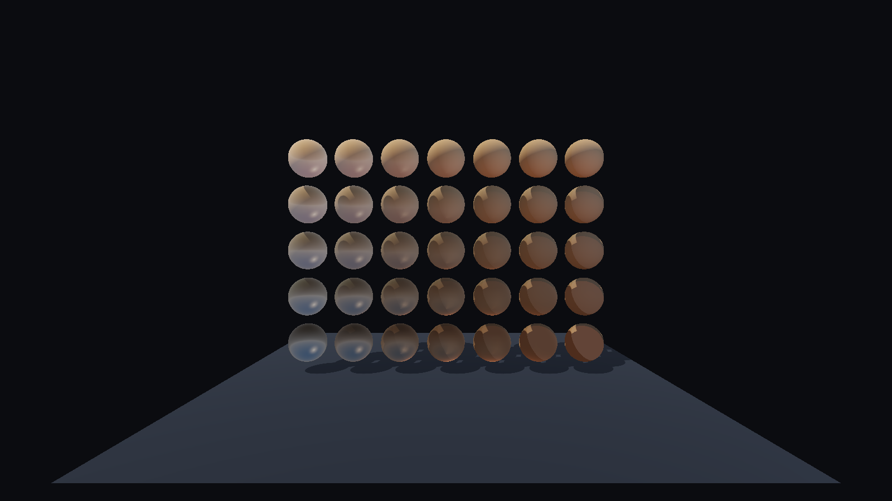

# Radiance4D

Hybrid real-time rendering and spatiotemporal reconstruction engine featuring 3D/4D Gaussian
Splatting, photogrammetry, ray tracing, and temporal stability.

C++20, with native Direct3D 12 and Vulkan backends.

## Status

Milestone M3 complete. Features marked *planned* are not implemented.

| Area | Status |
|---|---|
| Win32 platform layer, logging, timing | working |
| D3D12 device, explicit adapter selection | working |
| DirectX Agility SDK (retail 1.619.6) | working |
| Enhanced Barriers | working |
| Swapchain, frame synchronisation, resize | working |
| Build-time HLSL to DXIL (DXC 1.9.2609) | working |
| Debug layer, DRED, validation counters | working |
| Indexed and non-indexed geometry | working |
| GPU timestamp profiling | working |
| Headless rendering and frame capture | working |
| WARP image-regression tests, CI | working |
| Depth buffering | working |
| Orbit and free-fly cameras | working |
| glTF loading (cgltf) | working |
| PBR shading, analytic lights | working |
| Base colour, metallic-roughness, normal maps | working |
| ImGui statistics overlay | working (both backends) |
| Image-based lighting (procedural sky) | working |
| Shadow mapping (key light, PCF) | working |
| Exposure control | working |
| Vulkan backend (1.3, dynamic rendering, synchronization2) | working |
| Cross-API image parity test | working |
| 3D Gaussian Splatting (projection, sorting, compositing) | working (D3D12) |
| Gaussian splatting on Vulkan | planned (M4) |
| Dataset loading, GPU sorting, tiled binning, SH colour | planned (M4) |
| COLMAP / gsplat reconstruction | planned (M5) |
| Hybrid mesh and Gaussian rendering | working (shared depth buffer) |
| Temporal reprojection and denoising | planned (M7) |
| Dynamic 4D Gaussians | planned (M8) |



## Gaussian splatting

`--splats <n>` renders a deterministic procedural cloud of 3D Gaussians. Each splat carries a
position, a linear scale, a rotation quaternion, an opacity and a colour; the vertex shader builds
the 3D covariance, projects it with the perspective Jacobian into a screen-space conic, and expands
a quad from `SV_VertexID`. The pixel shader evaluates the conic and emits premultiplied alpha, and
the splats are composited back to front from a CPU depth sort.

Without `--scene` the splats replace the mesh scene; with one they share its depth buffer, so
geometry occludes the splats behind it.

```
radiance4d_viewer.exe --splats 20000
radiance4d_viewer.exe --splats 1200 --scene assets/DamagedHelmet/DamagedHelmet.glb
```

Current limits: D3D12 only, one draw call per cloud with no culling or tiled binning, a full CPU
sort every frame, and colour is the constant spherical-harmonic term rather than view-dependent
bands.

## Measurements

`--benchmark <n>` renders headless with the debug layer off, discards 64 warm-up frames and reports
CPU and GPU frame time. GPU time comes from timestamp queries around the frame. `--grid <cols>x<rows>`
sizes the built-in scene.

RTX 3080 Laptop GPU (GA104, 16 GB), driver 617.14, i7-11800H, RelWithDebInfo, vsync off, mean of the
measured frames:

| Scene | Resolution | Backend | CPU | GPU |
|---|---|---|---|---|
| 7x5 grid, 36 draws, 108k tris | 1920x1080 | D3D12 | 0.164 ms | 0.142 ms |
| 7x5 grid, 36 draws, 108k tris | 1920x1080 | Vulkan | 0.214 ms | 0.148 ms |
| 24x16 grid, 385 draws, 1.18M tris | 1920x1080 | D3D12 | 0.433 ms | 0.412 ms |
| 24x16 grid, 385 draws, 1.18M tris | 1920x1080 | Vulkan | 0.408 ms | 0.379 ms |
| 24x16 grid, 385 draws, 1.18M tris | 3840x2160 | D3D12 | 0.599 ms | 0.574 ms |
| 24x16 grid, 385 draws, 1.18M tris | 3840x2160 | Vulkan | 0.593 ms | 0.568 ms |

**What these do and do not show.** The scene never loads the GPU: 1.18 million triangles cost 0.41 ms,
and quadrupling the pixel count to 4K only reaches 0.57 ms, so the frame is bounded by fixed
per-frame cost rather than by geometry or fill. Headless means no present, so swapchain cost is
excluded.

The one thing the numbers do support is where the backends differ. On the light scene Vulkan is
0.05 ms behind on CPU; by 4K the two are within 0.006 ms of each other. The gap is command
submission overhead, which stops mattering as soon as the frame has real work in it, and it is not a
statement about shading performance. Drawing a D3D12-versus-Vulkan conclusion from this would be
wrong.

A scene heavy enough to be worth measuring, and a real profiler, are both still outstanding.

## Building

Windows 11, Visual Studio 2022 (v143), CMake 3.26+, a D3D12 GPU. Dependencies are fetched and
hash-pinned by CMake; nothing is installed system-wide.

```
cmake --preset windows-d3d12
cmake --build --preset windows-d3d12-debug
ctest --preset windows-d3d12-debug
```

See [docs/BUILDING.md](docs/BUILDING.md).

## Running

```
build/windows-d3d12/bin/Debug/radiance4d_viewer.exe
```

`--backend <d3d12|vulkan>`, `--scene <file.gltf>`, `--adapter <index|warp|name>`, `--no-vsync`, `--gpu-validation`,
`--frames <n>`, `--resize-cycles <n>`, `--log-level <0..5>`. `--help` lists all flags.
Without `--scene` a built-in material grid is rendered. Esc quits, F1 toggles vsync, F2 switches
camera mode; left mouse orbits, right pans, wheel zooms, WASDQE moves in free-fly. Exit code is non-zero if the
debug layer reported an error.

Headless, no GPU required:

```
radiance4d_viewer.exe --headless --frames 30 --fixed-step 0.0166667 --out frame.png
```

## Documentation

- [docs/ARCHITECTURE.md](docs/ARCHITECTURE.md)
- [docs/ROADMAP.md](docs/ROADMAP.md)
- [docs/BUILDING.md](docs/BUILDING.md)

## License

MIT, see [LICENSE](LICENSE).

Fetched at configure time under their own licenses: GLM (MIT), GoogleTest (BSD-3-Clause), DirectX
Shader Compiler (LLVM/NCSA + MIT), DirectX Agility SDK and WARP (Microsoft; `D3D12Core.dll`,
`d3d12SDKLayers.dll`, `d3dconfig.exe` and `d3d10warp.dll` are redistributable per the package terms),
stb (MIT / public domain), cgltf (MIT), Dear ImGui (MIT).
